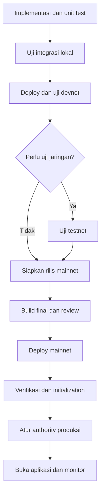
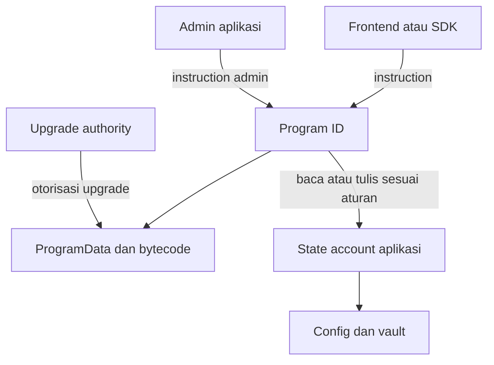
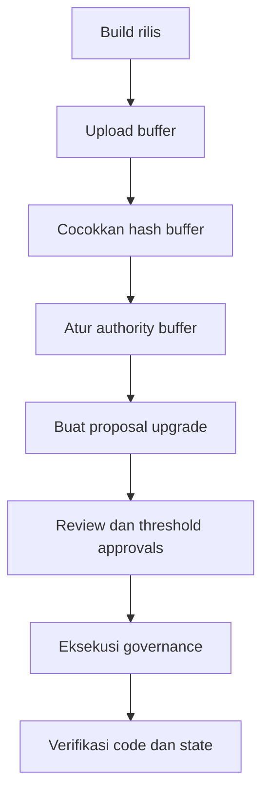

# Flow Lengkap Deployment Program Solana

**Cakupan:** local validator, devnet, testnet, mainnet, Program ID, initialization, verifikasi, authority, upgrade, dan operasional.

**Bahasa:** Indonesia. **Tanggal pemeriksaan dokumentasi:** 11 November 2026, WIB.

Dokumen ini merupakan runbook umum untuk program Rust dengan Anchor maupun native Rust. Contoh deployment menggunakan **Solana CLI dan upgradeable loader-v3**. Bagian Anchor digunakan hanya jika proyek menggunakan Anchor. Program dengan loader lain memerlukan prosedur yang sesuai loader tersebut.

Ini adalah panduan dan template, bukan laporan deployment yang sudah dilakukan. Tidak ada Program ID, wallet, transaksi, atau status mainnet yang diklaim telah dibuat. Semua nilai `<...>` harus diganti dengan data proyek. Perintah transaksi hanya dijalankan setelah konfigurasi untuk cluster tujuan selesai diperiksa. Contoh Bash telah diperiksa sintaksnya; deployment belum dijalankan terhadap proyek nyata.

## Daftar isi

1. [Alur utama](#1-alur-utama)
2. [Istilah dan relasi account](#2-istilah-dan-relasi-account)
3. [Pemilihan cluster](#3-pemilihan-cluster)
4. [Kebijakan Program ID](#4-kebijakan-program-id)
5. [Struktur proyek dan penyimpanan key](#5-struktur-proyek-dan-penyimpanan-key)
6. [Persiapan toolchain](#6-persiapan-toolchain)
7. [Wallet dan Program ID](#7-wallet-dan-program-id)
8. [Konfigurasi cluster dan pemeriksaan awal](#8-konfigurasi-cluster-dan-pemeriksaan-awal)
9. [Sinkronisasi source, Program ID, dan IDL](#9-sinkronisasi-source-program-id-dan-idl)
10. [Build dan pengujian lokal](#10-build-dan-pengujian-lokal)
11. [Artefak rilis dan verifiable build](#11-artefak-rilis-dan-verifiable-build)
12. [Estimasi biaya dan pendanaan](#12-estimasi-biaya-dan-pendanaan)
13. [Deployment devnet](#13-deployment-devnet)
14. [Deployment testnet](#14-deployment-testnet)
15. [Initialization dan integrasi aplikasi](#15-initialization-dan-integrasi-aplikasi)
16. [Deployment mainnet](#16-deployment-mainnet)
17. [Verifikasi onchain dan source](#17-verifikasi-onchain-dan-source)
18. [Publikasi IDL](#18-publikasi-idl)
19. [Authority dan multisig](#19-authority-dan-multisig)
20. [Upgrade dan migrasi state](#20-upgrade-dan-migrasi-state)
21. [Recovery dan troubleshooting](#21-recovery-dan-troubleshooting)
22. [Manifest dan bukti deployment](#22-manifest-dan-bukti-deployment)
23. [CI/CD dan monitoring](#23-cicd-dan-monitoring)
24. [Checklist penyelesaian](#24-checklist-penyelesaian)
25. [Referensi resmi](#25-referensi-resmi)

## 1. Alur utama

**Jalur aplikasi yang disarankan: localnet → devnet → mainnet.** Testnet merupakan cabang tambahan bila ada kebutuhan menguji kompatibilitas jaringan atau perilaku validator. Lulus testnet tidak menggantikan pengujian aplikasi di devnet. [S1]



Tentukan hasil yang harus tersedia pada setiap tahap:

| Tahap | Hasil yang dicatat | Syarat melanjutkan |
| --- | --- | --- |
| Desain | Daftar program, state account, authority, dependency | Hubungan antarprogram dan akses admin jelas |
| Lokal | Hasil tes dan skenario kegagalan | Alur penting dan penolakan akses ilegal lulus |
| Devnet | Program ID, transaksi, state, uji aplikasi | Alur pengguna dan integrasi jaringan publik berhasil |
| Testnet, opsional | Hasil pengujian khusus | Tujuan pengujian jaringan tercapai |
| Rilis mainnet | Commit, versi toolchain, binary, hash, IDL | Artefak yang akan dideploy dapat ditelusuri |
| Mainnet | ProgramData, authority, slot, transaksi init | Code, konfigurasi, dan account produksi benar |
| Operasional | Monitor, prosedur upgrade, penanggung jawab | Tim dapat mendeteksi dan menangani masalah |

**Deployment binary dan peluncuran aplikasi adalah dua langkah berbeda.** Program yang sudah executable belum tentu memiliki konfigurasi, vault, market, pool, atau treasury yang siap dipakai.

## 2. Istilah dan relasi account

Di Solana, smart contract biasanya disebut **program**. Untuk program custom, identitas publik yang diberikan kepada frontend, SDK, dan integrator adalah **Program ID**. [S2]

| Istilah | Fungsi | Bukan |
| --- | --- | --- |
| Program ID | Alamat program yang dipanggil dalam instruction | Private key atau signature transaksi |
| Program account | Account executable; pada loader-v3 menunjuk ProgramData | Wallet deployer |
| ProgramData account | Menyimpan bytecode dan metadata upgrade loader-v3 | State bisnis aplikasi |
| Program keypair | Pada flow keypair biasa, menentukan alamat saat deployment pertama | Hak otomatis untuk upgrade setelah deploy |
| Deployer / fee payer | Membayar biaya transaksi dan pendanaan account | Selalu menjadi admin aplikasi |
| Upgrade authority | Mengotorisasi penggantian binary program | Otomatis menjadi mint authority atau admin protokol |
| Buffer account | Tempat upload binary sementara sebelum deploy/upgrade | Program produksi yang dipanggil pengguna |
| Application admin | Hak yang ditetapkan di logic/config program | Hak bawaan Solana CLI |
| PDA | Alamat turunan dari Program ID dan seeds, tanpa private key | Wallet JSON yang bisa ditandatangani langsung |
| IDL | Deskripsi interface instruction/account untuk client | Binary executable atau bukti keamanan |
| Mint address | Identitas token SPL tertentu | Program ID aplikasi custom |
| Transaction signature | Identitas satu transaksi | Alamat contract |

Untuk loader-v3, binary tersimpan terpisah dari state aplikasi. Mengganti binary tidak otomatis mengubah format account bisnis. Hak akses bisnis harus diperiksa oleh program sendiri. [S3][S13]



**Jika tujuanmu hanya membuat token:** biasanya cukup membuat mint melalui Token Program atau Token-2022 yang sudah tersedia. Mint tersebut memiliki alamat token sendiri; tidak wajib membuat program custom baru. Tentukan kebutuhan program custom dari logic bisnisnya, misalnya lending, bonding curve, escrow, atau AMM. [S14]

## 3. Pemilihan cluster

| Environment | Nama untuk Solana CLI | RPC publik / lokal | Dana | Penggunaan |
| --- | --- | --- | --- | --- |
| Lokal | `localhost` | `http://127.0.0.1:8899` | SOL lokal | Pengujian cepat dan terisolasi |
| Devnet | `devnet` | `https://api.devnet.solana.com` | SOL uji | Pengembangan aplikasi dan demo publik |
| Testnet | `testnet` | `https://api.testnet.solana.com` | SOL uji | Uji jaringan, validator, kompatibilitas |
| Mainnet | `mainnet-beta` | `https://api.mainnet.solana.com` | SOL nyata | Produksi |

Nama `mainnet-beta` masih dipakai sebagai moniker CLI. Dokumentasi/toolchain tertentu juga mencantumkan endpoint `https://api.mainnet-beta.solana.com`. Pilih endpoint yang didukung penyedia dan verifikasi cluster-nya. [S1][S4]

Devnet dan testnet adalah ledger terpisah dan dapat direset. Saldo, account, mint, liquidity, dan konfigurasi tidak ikut berpindah ke mainnet. RPC publik memiliki batas penggunaan; untuk proses rilis produksi, siapkan endpoint dengan kapasitas yang memadai. [S1]

Solana tidak memakai parameter EVM seperti `chainId: 4663` untuk flow ini. Simpan identitas cluster, RPC, dan **genesis hash**. `getGenesisHash` mengembalikan identitas genesis dari cluster yang sedang dihubungi. [S12]

Template Explorer:

| Objek | Devnet | Testnet | Mainnet |
| --- | --- | --- | --- |
| Program/account | `https://explorer.solana.com/address/<ADDRESS>?cluster=devnet` | `https://explorer.solana.com/address/<ADDRESS>?cluster=testnet` | `https://explorer.solana.com/address/<ADDRESS>` |
| Transaksi | `https://explorer.solana.com/tx/<SIGNATURE>?cluster=devnet` | `https://explorer.solana.com/tx/<SIGNATURE>?cluster=testnet` | `https://explorer.solana.com/tx/<SIGNATURE>` |

## 4. Kebijakan Program ID

Pilih salah satu strategi sebelum membuat alamat rilis. Ini keputusan organisasi proyek, bukan kewajiban protokol.

| Strategi | Keuntungan | Konsekuensi |
| --- | --- | --- |
| ID berbeda per cluster | Alamat development dan produksi mudah dibedakan | Source declaration, binary, IDL, dan client harus sesuai setiap cluster |
| ID sama di beberapa cluster | Referensi alamat lintas environment lebih sederhana | Tetap harus deploy dan initialize terpisah; cluster tidak boleh ditebak dari alamat |

Runbook ini menggunakan **keypair/ID terpisah per cluster** sebagai default. Program keypair yang sama dapat menghasilkan Program ID yang sama di cluster berbeda, tetapi tidak membagikan state atau authority onchain antarcluster. [S10]

Aturan kerja yang disarankan:

- Tetapkan Program ID mainnet sebelum membangun artefak rilis mainnet.
- Buat keypair program satu kali untuk identitas tersebut; jangan buat ulang setiap deploy.
- Simpan salinan aman di luar `target/`; pembersihan build tidak boleh menghapus satu-satunya salinan.
- Catat Program ID publik di manifest. Jangan menaruh isi keypair dalam manifest atau repo.
- Jalankan build dalam checkout/worktree khusus rilis ketika ID berbeda antarcluster.
- Setelah mengganti ID, lakukan build ulang. Mengubah `.env` frontend saja tidak mengubah ID yang tertanam di binary.

PDA mengikuti Program ID dan seeds. Jika ID berubah, PDA dengan seeds yang sama berubah. Jika ID dan seeds sama lintas cluster, alamat turunannya bisa sama, tetapi keberadaan dan isinya tetap terpisah. Menghitung alamat PDA juga tidak otomatis membuat account-nya. [S11]

## 5. Struktur proyek dan penyimpanan key

Contoh pembagian tanggung jawab direktori:

| Path | Isi | Masuk Git? |
| --- | --- | --- |
| `programs/my_program/` | Source program | Ya |
| `tests/` | Unit, integrasi, dan tes keamanan | Ya |
| `scripts/` | Validasi, initialization, smoke test, migrasi | Ya, tanpa secret |
| `deployments/devnet/` | Manifest publik devnet | Ya |
| `deployments/testnet/` | Manifest publik testnet | Ya |
| `deployments/mainnet/` | Manifest publik produksi | Ya |
| `idl/` | Salinan IDL rilis yang sudah direview | Ya jika menjadi sumber integrasi |
| `releases/<cluster>/<release>/` | Binary dan bukti rilis | Simpan di artifact store; tidak wajib Git |
| `target/` | Hasil build sementara | Tidak |
| `~/.config/solana/my_project/<cluster>/` | Keypair lokal | Tidak |

Contoh `.gitignore`:

```gitignore
target/
node_modules/
.anchor/
test-ledger/
.env
.env.*
!.env.example
keys/
secrets/
**/*-keypair.json
*.log
```

Jangan mengabaikan semua file `*.json`: IDL, konfigurasi publik, dan manifest justru perlu ditelusuri. `.gitignore` tidak menghapus secret yang sudah pernah masuk Git. Jika secret pernah terunggah, tangani rotasi authority/key dan riwayatnya secara terpisah.

Pisahkan data menurut tingkat akses:

- **Publik:** Program ID, mint, PDA, authority public key, signature, hash, commit.
- **Privat operasional:** RPC ber-API-key, detail akses provider, kredensial indexer.
- **Secret penandatangan:** seed phrase, JSON keypair, secret key, akses signer.

Frontend hanya menerima data publik dan akses RPC yang memang disiapkan untuk client. Jangan pernah meletakkan secret key di variabel `NEXT_PUBLIC_*`.

## 6. Persiapan toolchain

Siapkan Rust/Cargo, Solana CLI dari Agave, Git, dan Python 3 untuk helper pada dokumen ini. Tambahkan Anchor CLI bila menggunakan Anchor; Docker untuk verifiable build; Node.js/package manager hanya bila client atau tes proyek memerlukannya.

Gunakan panduan instalasi resmi [S5]. Untuk pemakaian produksi, tetapkan versi yang kompatibel dengan proyek, bukan otomatis mengganti ke versi terbaru di tengah rilis.

Contoh instalasi Solana CLI dengan tag yang sudah dipilih:

```bash
# Isi dengan tag Agave yang dipilih proyek, misalnya format vX.Y.Z.
export SOLANA_RELEASE_TAG='<AGAVE_RELEASE_TAG>'
curl -fsSL "https://release.anza.xyz/${SOLANA_RELEASE_TAG}/install" \
  -o /tmp/my-project-agave-install.sh
# Tinjau installer dari sumber resmi sebelum menjalankannya.
sh /tmp/my-project-agave-install.sh
```

Ikuti petunjuk PATH dari installer. Setelah AVM terpasang mengikuti [S5], pilih versi Anchor:

```bash
export ANCHOR_VERSION='<ANCHOR_VERSION>'
avm install "$ANCHOR_VERSION"
avm use "$ANCHOR_VERSION"
```

Catat versi aktual:

```bash
rustc --version
cargo --version
solana --version
solana-keygen --version
anchor --version       # Hanya proyek Anchor.
docker --version      # Untuk verifiable build.
```

Periksa bantuan CLI untuk versi yang benar-benar dipakai:

```bash
solana program deploy --help
solana program write-buffer --help
solana program set-upgrade-authority --help
anchor build --help
anchor test --help
anchor idl --help
```

Commit `Cargo.lock`, lockfile package manager, dan konfigurasi versi toolchain. Catat juga versi SBF/platform-tools, build image/digest, serta feature flags. Rust host dan toolchain SBF yang menghasilkan program tidak selalu identik.

Dokumentasi Anchor terbaru telah mengubah beberapa alur, termasuk metadata IDL dan tooling lokal. Cocokkan CLI, crate `anchor-lang`, library client, IDL format, dan validator lokal. Jangan mencampur tutorial Anchor lama dengan CLI baru tanpa pemeriksaan kompatibilitas. [S6][S7]

## 7. Wallet dan Program ID

### 7.1 Tentukan environment yang sedang disiapkan

Contoh berikut dijalankan di Bash. Kerjakan satu cluster pada satu waktu.

```bash
export SOLANA_CLUSTER='devnet'
export PROGRAM_NAME='my_program'
export SOLANA_KEY_DIR="$HOME/.config/solana/my_project/$SOLANA_CLUSTER"

umask 077
mkdir -p "$SOLANA_KEY_DIR"
chmod 700 "$SOLANA_KEY_DIR"

export DEPLOYER_KEYPAIR="$SOLANA_KEY_DIR/deployer-keypair.json"
export PROGRAM_KEYPAIR="$SOLANA_KEY_DIR/${PROGRAM_NAME}-keypair.json"
export UPGRADE_AUTHORITY_KEYPAIR="$SOLANA_KEY_DIR/upgrade-authority-keypair.json"
```

### 7.2 Buat keypair hanya jika belum ada

Contoh file signer ini cocok untuk latihan dan bootstrap yang dikelola. Untuk authority produksi jangka panjang, gunakan custody atau multisig yang sudah dipilih tim.

```bash
if [ ! -e "$DEPLOYER_KEYPAIR" ]; then
  solana-keygen new --outfile "$DEPLOYER_KEYPAIR"
fi

if [ ! -e "$PROGRAM_KEYPAIR" ]; then
  solana-keygen new --outfile "$PROGRAM_KEYPAIR"
fi

if [ ! -e "$UPGRADE_AUTHORITY_KEYPAIR" ]; then
  solana-keygen new --outfile "$UPGRADE_AUTHORITY_KEYPAIR"
fi

chmod 600 "$DEPLOYER_KEYPAIR" "$PROGRAM_KEYPAIR" "$UPGRADE_AUTHORITY_KEYPAIR"

export DEPLOYER_ADDRESS="$(solana-keygen pubkey "$DEPLOYER_KEYPAIR")"
export PROGRAM_ID="$(solana-keygen pubkey "$PROGRAM_KEYPAIR")"
export UPGRADE_AUTHORITY_ADDRESS="$(solana-keygen pubkey "$UPGRADE_AUTHORITY_KEYPAIR")"

printf 'Deployer: %s\nProgram ID: %s\nUpgrade authority: %s\n' \
  "$DEPLOYER_ADDRESS" "$PROGRAM_ID" "$UPGRADE_AUTHORITY_ADDRESS"
```

Jangan pakai `--force` untuk mengatasi keypair yang sudah ada. Periksa apakah file tersebut identitas yang memang ingin digunakan. Lakukan backup dan uji pemulihan sesuai pengelolaan key tim. Passphrase mnemonic tidak otomatis berarti JSON keypair di disk terenkripsi.

Jangan merekam output seed phrase ke log CI, screenshot publik, atau manifest. Public key boleh dicatat; isi file keypair tidak boleh.

**Membuat Program ID di langkah ini belum melakukan deployment.** Alamat baru menjadi program executable setelah deployment onchain berhasil.

## 8. Konfigurasi cluster dan pemeriksaan awal

Jangan mengandalkan default global CLI yang mungkin tertinggal dari pekerjaan lain. Semua perintah jaringan pada runbook memakai `--url` eksplisit.

```bash
# Pilih endpoint sesuai SOLANA_CLUSTER.
export SOLANA_RPC_URL='https://api.devnet.solana.com'

# Ambil dari catatan baseline cluster yang telah diverifikasi secara independen.
export SOLANA_EXPECTED_GENESIS_HASH='<VERIFIED_CLUSTER_GENESIS_HASH>'

: "${SOLANA_CLUSTER:?Cluster wajib diisi}"
: "${SOLANA_RPC_URL:?RPC wajib diisi}"
: "${SOLANA_EXPECTED_GENESIS_HASH:?Genesis hash wajib diisi}"
: "${PROGRAM_ID:?Program ID wajib diisi}"
: "${DEPLOYER_KEYPAIR:?Deployer wajib diisi}"

case "$SOLANA_CLUSTER" in
  localnet|devnet|testnet|mainnet) ;;
  *) printf 'Cluster tidak didukung\n' >&2; exit 1 ;;
esac

ACTUAL_GENESIS_HASH="$(solana --url "$SOLANA_RPC_URL" genesis-hash)" || exit 1
if [ "$ACTUAL_GENESIS_HASH" != "$SOLANA_EXPECTED_GENESIS_HASH" ]; then
  printf 'STOP: genesis hash tidak cocok dengan cluster tujuan\n' >&2
  exit 1
fi

solana --url "$SOLANA_RPC_URL" cluster-version
solana --url "$SOLANA_RPC_URL" slot
solana --url "$SOLANA_RPC_URL" --keypair "$DEPLOYER_KEYPAIR" address
solana --url "$SOLANA_RPC_URL" --keypair "$DEPLOYER_KEYPAIR" balance
```

Cara menetapkan baseline: bandingkan `genesis-hash` melalui endpoint cluster resmi dan endpoint provider yang dipercaya, lalu catat hasil yang direview. Jangan mengisi expected hash secara otomatis dari RPC yang sedang diperiksa dalam script yang sama. Untuk localnet yang baru direset, baseline lokal memang perlu dicatat ulang.

RPC error harus menghentikan deployment. Jangan mengubah cluster, memakai alamat default, atau meneruskan dengan nilai kosong ketika konfigurasi hilang.

## 9. Sinkronisasi source, Program ID, dan IDL

### 9.1 Untuk Anchor

Pastikan semua referensi berikut sesuai target:

1. Public key dari `PROGRAM_KEYPAIR`.
2. `declare_id!` di source program.
3. Mapping cluster yang dipakai dalam `Anchor.toml`.
4. Program ID pada IDL rilis.
5. Manifest dan client aplikasi.

Contoh source, ganti placeholder dengan public key nyata:

```rust
use anchor_lang::prelude::*;

declare_id!("<PROGRAM_ID_UNTUK_BUILD_INI>");
```

Contoh potongan `Anchor.toml`:

```toml
[programs.localnet]
my_program = "<LOCALNET_PROGRAM_ID>"

[programs.devnet]
my_program = "<DEVNET_PROGRAM_ID>"

[programs.testnet]
my_program = "<TESTNET_PROGRAM_ID>"

[programs.mainnet]
my_program = "<MAINNET_PROGRAM_ID>"

[provider]
cluster = "Devnet"
wallet = "<ABSOLUTE_PATH_TO_DEVNET_DEPLOYER>"
```

`[programs.mainnet]` adalah nama tabel Anchor; jangan menggantinya menjadi `[programs.mainnet-beta]` hanya karena moniker Solana CLI memakai `mainnet-beta`.

Mapping empat cluster di `Anchor.toml` **tidak otomatis mengganti `declare_id!` yang dikompilasi**. Dengan strategi ID terpisah, pilih ID target melalui perubahan source yang dicatat di commit rilis atau mekanisme build feature yang eksplisit. Rebuild setelah memilihnya. [S8][S9]

Untuk tes yang menggunakan keypair di output build, letakkan salinan target di path konvensional setelah memastikan tidak menimpa identitas yang belum dibackup:

```bash
mkdir -p target/deploy
install -m 600 "$PROGRAM_KEYPAIR" "target/deploy/${PROGRAM_NAME}-keypair.json"
anchor keys list
```

`anchor keys sync` dapat membantu sinkronisasi, tetapi tinjau diff karena efeknya terhadap source/config bergantung versi dan workspace. Jangan menjalankannya tanpa review di workspace yang menyimpan beberapa ID cluster.

### 9.2 Untuk native Rust atau framework lain

Pilih Program ID yang sama untuk declaration/check program, script deploy, dan client. Tidak semua native program menggunakan `declare_id!`; ikuti mekanisme identitas framework tersebut. Periksa juga alamat CPI yang tertanam dalam source.

### 9.3 Banyak program dalam satu protokol

Sediakan satu entri manifest dan satu kebijakan authority untuk setiap program. Buat semua ID terlebih dahulu agar dependency dapat ditentukan sebelum build. Susun urutan deploy dari program dependency menuju pemanggilnya. Initialization dapat memerlukan urutan berbeda, misalnya config sebelum market dan vault.

Solana tidak otomatis memerlukan pola proxy EVM. Upgrade loader-v3 mengganti binary pada Program ID yang sama; arsitektur routing tambahan dipilih hanya jika logic proyek memerlukannya. [S3]

## 10. Build dan pengujian lokal

### 10.1 Build

Pilih satu jalur sesuai proyek:

```bash
# Anchor, dari root workspace:
anchor build
```

```bash
# Native Rust, dari direktori crate program:
cargo build-sbf
```

Artefak normal biasanya berada di `target/deploy/<nama_lib>.so`. Nama file mengikuti nama library crate, yang dapat berbeda dari nama folder/package. Pada Anchor, IDL biasanya ada di `target/idl/`. [S9]

### 10.2 Tes aplikasi

Untuk proyek Anchor, gunakan konfigurasi lokal dan runner yang memang dipakai proyek:

```bash
anchor test --provider.cluster localnet --provider.wallet "$DEPLOYER_KEYPAIR"
```

Versi/template tertentu menjalankan VM in-process seperti LiteSVM, sementara template lain memakai validator. Jangan menyimpulkan bahwa `anchor test` selalu menguji proses deploy/upgrade melalui loader. Tambahkan rehearsal deployment berikut untuk menguji operasionalnya. [S8]

### 10.3 Rehearsal deploy dengan validator lokal

Terminal pertama:

```bash
# Menggunakan ledger terpisah. Tambahkan --reset hanya jika ingin menghapus state lokal.
solana-test-validator --ledger ./test-ledger
```

Terminal kedua, setelah memilih keypair dan build yang sesuai ID lokal:

```bash
solana --url http://127.0.0.1:8899 airdrop 10 "$DEPLOYER_ADDRESS"

solana --url http://127.0.0.1:8899 \
  --keypair "$DEPLOYER_KEYPAIR" \
  program deploy "target/deploy/${PROGRAM_NAME}.so" \
  --program-id "$PROGRAM_KEYPAIR" \
  --upgrade-authority "$UPGRADE_AUTHORITY_KEYPAIR"

solana --url http://127.0.0.1:8899 program show "$PROGRAM_ID"
```

Angka airdrop hanya untuk latihan, bukan estimasi biaya deployment. Gunakan saldo lokal yang cukup bagi ukuran program.

Tes minimum yang disarankan untuk proyek yang mengelola aset:

- Instruction utama berhasil dengan account dan signer yang benar.
- Signer hilang atau admin salah ditolak.
- Account owner, mint, token program, seeds, dan bump salah ditolak.
- Initialization ulang dan pengambilalihan admin pertama ditolak.
- Batas nominal, pembulatan, overflow, dan accounting konsisten.
- CPI hanya menuju dependency yang disetujui.
- Oracle stale atau data harga tidak valid ditolak bila ada oracle.
- Upgrade tidak merusak pembacaan account versi lama.
- Migrasi state bisa dicoba ulang tanpa menggandakan perubahan.
- Alur gagal tidak meninggalkan state parsial yang tidak diinginkan.

Uji fungsi spesifik seperti swap, deposit/withdraw, borrow/repay, atau graduation sesuai program yang benar-benar dibuat. Jangan menambahkan klaim lulus untuk fungsi yang tidak diuji.

## 11. Artefak rilis dan verifiable build

### 11.1 Bekukan identitas rilis

Setelah source, Program ID target, konfigurasi build, dan tes selesai, buat commit rilis yang akan diverifikasi. Siapkan juga metadata versi build pada bagian 11.3 sebelum membekukan commit. Jangan mengambil commit hash sebelum perubahan source terakhir tercatat.

```bash
git status --short
git diff --exit-code
git diff --cached --exit-code
export RELEASE_COMMIT="$(git rev-parse HEAD)"
export RELEASE_LABEL='<RELEASE_LABEL>'
export RELEASE_DIR="$PWD/releases/$SOLANA_CLUSTER/$RELEASE_LABEL"
mkdir -p "$RELEASE_DIR"
```

Dua perintah `git diff` tidak mencakup file untracked. Tinjau `git status` juga. Simpan output rilis di direktori yang sesuai kebijakan repo.

### 11.2 Build normal untuk iterasi devnet

```bash
# Sesudah anchor build atau cargo build-sbf:
install -m 644 "target/deploy/${PROGRAM_NAME}.so" "$RELEASE_DIR/${PROGRAM_NAME}.so"
export PROGRAM_BINARY="$RELEASE_DIR/${PROGRAM_NAME}.so"

# Hanya Anchor:
install -m 644 "target/idl/${PROGRAM_NAME}.json" "$RELEASE_DIR/${PROGRAM_NAME}.json"
export PROGRAM_IDL="$RELEASE_DIR/${PROGRAM_NAME}.json"
```

### 11.3 Build yang dapat direproduksi untuk produksi

Pilih **satu** pipeline dan pertahankan pipeline yang sama saat verifikasi.

| Jalur | Build | Artefak yang harus dideploy | Verifikasi |
| --- | --- | --- | --- |
| Solana Verify | `solana-verify build --library-name "$PROGRAM_NAME"` | Output `.so` dari build tersebut | `solana-verify verify-from-repo` |
| Anchor | `anchor build --verifiable` | Output di `target/verifiable/` sesuai log versi CLI | `anchor verify` |

Untuk Solana Verify, install versi yang dikunci:

```bash
export SOLANA_VERIFY_VERSION='<SOLANA_VERIFY_VERSION>'
cargo install solana-verify --version "$SOLANA_VERIFY_VERSION" --locked
solana-verify --version
```

Tooling terbaru menggunakan metadata versi Solana untuk memilih build image, kecuali image ditentukan secara eksplisit. Sebagai persiapan sebelum membekukan commit pada bagian 11.1, tambahkan versi yang benar ke root `Cargo.toml` sesuai dokumentasi versi yang dipakai: [S16]

```toml
[workspace.metadata.cli]
solana = "<PINNED_SOLANA_VERSION>"
```

Untuk Anchor, hasilkan IDL rilis terlebih dahulu dari source/feature target. Langkah ini dijalankan sebelum build verifiable final, sehingga binary biasa tidak menimpa binary final:

```bash
anchor build
install -m 644 "target/idl/${PROGRAM_NAME}.json" "$RELEASE_DIR/${PROGRAM_NAME}.json"
export PROGRAM_IDL="$RELEASE_DIR/${PROGRAM_NAME}.json"
```

Untuk jalur Solana Verify, jalankan di workspace dan salin **hasil build tersebut**:

```bash
solana-verify build --library-name "$PROGRAM_NAME"
install -m 644 "target/deploy/${PROGRAM_NAME}.so" "$RELEASE_DIR/${PROGRAM_NAME}.so"
export PROGRAM_BINARY="$RELEASE_DIR/${PROGRAM_NAME}.so"
solana-verify get-executable-hash "$PROGRAM_BINARY"
```

Untuk jalur Anchor verifiable, salin binary yang dilaporkan di `target/verifiable/`, bukan output build biasa di `target/deploy/`. [S15]

Jangan menjalankan build biasa lalu memakai hasilnya setelah menguji/verifikasi binary lain. Generate IDL dari source, features, dan commit yang sama; pastikan IDL rilis tidak berasal dari build cluster sebelumnya.

### 11.4 Periksa IDL dan hash artefak

Contoh validasi berikut khusus IDL modern dengan field `address`:

```bash
python3 - "$PROGRAM_IDL" "$PROGRAM_ID" <<'PY'
import json, sys
with open(sys.argv[1], encoding='utf-8') as handle:
    idl = json.load(handle)
if idl.get('address') != sys.argv[2]:
    raise SystemExit('STOP: IDL address tidak cocok dengan Program ID target')
print('IDL address cocok')
PY
```

Untuk format IDL lama, gunakan validator khusus format tersebut; jangan membuat fallback yang diam-diam mengganti alamat.

Catat SHA-256 file untuk integritas artefak:

```bash
python3 - "$PROGRAM_BINARY" <<'PY'
import hashlib, pathlib, sys
path = pathlib.Path(sys.argv[1])
print(hashlib.sha256(path.read_bytes()).hexdigest(), path.name)
PY
```

SHA-256 file rilis berguna untuk memastikan file tidak tertukar. Verifikasi code onchain menggunakan metode executable hash dari tooling yang dipilih; hash file mentah dan hash executable tidak boleh dianggap identik tanpa memeriksa format/padding.

## 12. Estimasi biaya dan pendanaan

Jangan menetapkan angka universal seperti “deploy pasti 2 SOL”. Anggaran perlu mengikuti ukuran binary, kapasitas ProgramData, buffer, account aplikasi, biaya transaksi, serta kondisi jaringan.

Pisahkan komponen anggaran:

| Komponen | Kapan diperlukan | Cara menganggarkan |
| --- | --- | --- |
| Program account dan ProgramData | Deployment pertama | Ukuran account dan kapasitas rilis |
| Buffer upload | Deploy/upgrade | Kebutuhan dana sementara saat upload |
| Pertumbuhan ProgramData | Binary lebih besar dari kapasitas sebelumnya | Selisih kebutuhan storage |
| Config, market, vault, ATA | Initialization | Daftar account dan ukuran aktual |
| Transaction fee | Upload, deploy, init, verifikasi, transfer authority | Jumlah transaksi dan signer |
| Priority fee | Bila dipakai | Compute unit price dan limit yang dipilih |
| Cadangan retry | Saat upload/konfirmasi terganggu | Hasil rehearsal dan kondisi RPC |

Hitung ukuran binary dan indikasi minimum balance untuk ukuran tersebut:

```bash
export PROGRAM_BYTES="$(wc -c < "$PROGRAM_BINARY" | tr -d '[:space:]')"
printf 'Ukuran binary: %s bytes\n' "$PROGRAM_BYTES"
solana --url "$SOLANA_RPC_URL" rent "$PROGRAM_BYTES"
```

**Hasil ini bukan total harga deployment.** Ia hanya estimasi satu ukuran data. Hitung account aktual beserta metadata/kapasitas dan kebutuhan buffer. Minimum lamports untuk panjang data tertentu dapat dibaca melalui `getMinimumBalanceForRentExemption`. [S17]

Untuk devnet/testnet, minta SOL uji sesuai ketersediaan faucet:

```bash
solana --url "$SOLANA_RPC_URL" airdrop 2 "$DEPLOYER_ADDRESS"
solana --url "$SOLANA_RPC_URL" --keypair "$DEPLOYER_KEYPAIR" balance
```

Airdrop dapat dibatasi atau gagal. Nilai `2` merupakan contoh permintaan, bukan jaminan cukup. Untuk mainnet, isi wallet deployer dengan SOL mainnet dari sumber dana yang dipilih; faucet devnet tidak mendanai mainnet.

## 13. Deployment devnet

### 13.1 Persiapan

- Pilih `SOLANA_CLUSTER=devnet` dan RPC devnet.
- Muat keypair devnet; hitung ulang public key dan `PROGRAM_ID`.
- Periksa genesis hash dan saldo.
- Sinkronkan source/config dengan ID devnet, lalu build dan bekukan artefak.
- Periksa apakah Program ID sudah memiliki program onchain.

```bash
solana --url "$SOLANA_RPC_URL" program show "$PROGRAM_ID"
```

“Account not found” dapat normal untuk deploy pertama. Bedakan dari timeout, rate limit, atau RPC error. Jika program sudah ada, cek loader dan authority; perlakukan proses berikut sebagai **upgrade**, bukan deployment pertama.

### 13.2 Deploy pertama

```bash
: "${PROGRAM_BINARY:?Binary rilis wajib diisi}"
: "${PROGRAM_KEYPAIR:?Program keypair wajib diisi}"
: "${UPGRADE_AUTHORITY_KEYPAIR:?Upgrade signer wajib diisi}"

solana --url "$SOLANA_RPC_URL" \
  --keypair "$DEPLOYER_KEYPAIR" \
  program deploy "$PROGRAM_BINARY" \
  --program-id "$PROGRAM_KEYPAIR" \
  --upgrade-authority "$UPGRADE_AUTHORITY_KEYPAIR"
```

Path keypair pada `--program-id` digunakan untuk pembuatan program baru dengan alamat yang telah dipilih. Upgrade authority diberikan terpisah agar tidak bergantung pada default signer. [S2][S18]

### 13.3 Setelah deploy

```bash
solana --url "$SOLANA_RPC_URL" --commitment finalized program show "$PROGRAM_ID"
solana --url "$SOLANA_RPC_URL" --commitment finalized account "$PROGRAM_ID" --output json
```

Catat ProgramData address, loader owner, authority, last-deployed slot, kapasitas data, dan signature transaksi deployment. Lanjutkan ke initialization, uji frontend/backend, dan rehearsal upgrade. Gunakan IDL yang sesuai rilis ini.

## 14. Deployment testnet

Gunakan cabang ini bila ada tujuan pengujian yang jelas, misalnya kompatibilitas dengan fitur jaringan baru atau perilaku program pada cluster testnet.

```bash
export SOLANA_CLUSTER='testnet'
export SOLANA_RPC_URL='https://api.testnet.solana.com'
```

Mengubah dua variabel ini **belum cukup**. Ulangi penetapan `SOLANA_KEY_DIR`, ketiga path keypair, alamat publik, genesis hash, release directory, source ID, binary, dan IDL untuk testnet. Variabel shell lama tidak otomatis mengikuti perubahan cluster.

Urutan kerja:

1. Siapkan keypair dan baseline testnet.
2. Pastikan dependency CPI/oracle yang diperlukan tersedia di testnet.
3. Build dengan ID testnet.
4. Isi saldo SOL uji.
5. Jalankan perintah deploy yang sama seperti devnet dengan variabel testnet.
6. Initialize state testnet.
7. Jalankan skenario pengujian yang ditentukan.
8. Simpan bukti dan hasil terpisah dari devnet.

Jika dependency tidak tersedia, tandai pengujian integrasi sebagai belum dilakukan. Jangan mengubah dependency ke alamat mainnet sambil tetap memakai RPC testnet, atau mengklaim hasil stub lokal sebagai bukti integrasi publik.

## 15. Initialization dan integrasi aplikasi

### 15.1 Initialization harus dirancang dalam program

Tidak ada satu perintah `solana initialize` yang berlaku untuk seluruh program. Gunakan instruction dan SDK proyek, misalnya `initialize_config`, `create_market`, atau `initialize_vault`. Nama-nama itu contoh; sesuaikan IDL sebenarnya.

Sebelum mengirim initialization, script proyek harus memeriksa:

- Cluster/genesis dan Program ID target.
- Program executable dan authority yang diharapkan.
- Account config sudah ada atau belum, berikut owner dan schema version.
- Signer initializer memang berwenang menurut logic program.
- Admin, treasury, fee, mint, token program, oracle, dan dependency benar.
- PDA dihitung dari seeds yang benar untuk ID ini.

Instruction initializer harus mencegah pihak lain mengambil alih config pertama. Gunakan aturan autentikasi yang eksplisit, misalnya authority yang telah ditetapkan atau pemeriksaan ProgramData upgrade authority jika desainnya demikian. Jangan hanya membiarkan caller pertama menjadi admin.

### 15.2 Urutan contoh untuk protokol keuangan

| Urutan | Operasi | Bukti yang diperiksa |
| --- | --- | --- |
| 1 | Initialize config | Admin, versi schema, status pause |
| 2 | Register dependency | Program/mint/oracle sesuai target cluster |
| 3 | Buat vault/ATA | Mint, token program, dan authority vault |
| 4 | Buat market/pool | Parameter dan fee sesuai konfigurasi |
| 5 | Set batas awal | Cap/limit dan akses operator |
| 6 | Smoke test | Saldo, state, event, dan signature sesuai harapan |

Tahap ini perlu disesuaikan dengan fungsi aplikasi. Deployment baru tidak otomatis memanggil semua instruction initialization.

### 15.3 Sambungkan FE, BE, dan indexer

| Komponen | Konfigurasi yang diperlukan |
| --- | --- |
| Frontend (FE) | Cluster, Program ID, IDL/client, mint/PDA publik, endpoint browser |
| Backend (BE) / API | RPC privat, konfigurasi cluster, program, izin service signer bila diperlukan |
| Indexer | Program ID, slot awal rilis, schema/event decoder, strategi backfill |
| Database | Pemisahan data cluster dan constraint identitas |
| Monitoring | ProgramData, authority, transaksi gagal, dependency, kesehatan RPC |

Satu `.env` atau beberapa file konfigurasi sama-sama bisa digunakan. Yang wajib: pemilihan cluster eksplisit, semua nilai tervalidasi, dan tidak ada fallback ke mainnet/devnet ketika nilai hilang. Untuk mode switch, ganti endpoint, IDL, Program ID, alamat aset, serta cache/query key sebagai satu konfigurasi.

Gunakan identitas gabungan seperti `(cluster, program_id, account_address)` di database. Jangan mencampur histori karena dua cluster memakai alamat program yang sama.

## 16. Deployment mainnet

### 16.1 Persiapan rilis

Checklist berikut adalah rekomendasi proses rilis tim:

- [ ] Fungsi dan akses admin telah direview sesuai risiko aplikasi.
- [ ] Tes lokal dan devnet lulus; rehearsal init, upgrade, dan recovery tersedia.
- [ ] Program ID mainnet sudah dipilih dan dibackup.
- [ ] Source declaration, IDL, dan dependency mainnet sudah sesuai.
- [ ] Commit serta toolchain build final tercatat.
- [ ] Binary verifiable yang akan dideploy sudah dibekukan.
- [ ] Wallet deployer berisi dana cukup sesuai estimasi dan cadangan.
- [ ] Authority tujuan, anggota multisig, threshold, dan kemampuan eksekusi sudah diuji.
- [ ] Parameter produksi dan script initialization direview.
- [ ] Tim tahu cara pause/cap jika program mendukungnya dan cara merespons insiden.

### 16.2 Pilih konfigurasi mainnet

```bash
export SOLANA_CLUSTER='mainnet'
export SOLANA_RPC_URL='<MAINNET_RPC_URL>'
export SOLANA_EXPECTED_GENESIS_HASH='<VERIFIED_MAINNET_GENESIS_HASH>'
```

Ulangi penetapan keypair/alamat pada bagian 7 untuk mainnet, pemeriksaan bagian 8, sinkronisasi bagian 9, dan build final bagian 11. **Jangan memakai binary devnet yang masih memuat ID devnet.**

### 16.3 Deploy binary final

```bash
solana --url "$SOLANA_RPC_URL" \
  --keypair "$DEPLOYER_KEYPAIR" \
  program deploy "$PROGRAM_BINARY" \
  --program-id "$PROGRAM_KEYPAIR" \
  --upgrade-authority "$UPGRADE_AUTHORITY_KEYPAIR"
```

Ini contoh deployment pertama dengan authority bootstrap berupa signer yang tersedia. Jika sejak awal memakai governance deployment, gunakan flow governance yang mendukung creation/upgrade pada loader yang dipilih. Jangan memasukkan PDA multisig sebagai path private key.

### 16.4 Urutan setelah transaksi berhasil

1. Konfirmasi transaksi dan baca ulang account dengan commitment `finalized`.
2. Pastikan Program ID, executable flag, loader, ProgramData, dan authority benar.
3. Verifikasi binary terhadap source/commit rilis.
4. Publish IDL bila dipilih dan lakukan initialization berotorisasi.
5. Periksa semua state/config yang baru dibuat.
6. Pindahkan authority sesuai rencana governance dan verifikasi ulang.
7. Jalankan smoke test nominal kecil sesuai fungsi aplikasi.
8. Aktifkan frontend/backend/indexer produksi dan monitor.
9. Publikasikan manifest serta bukti transaksi yang sudah dikonfirmasi.

Jika aplikasi mendukung pause/cap, initialization dapat menahan aktivitas publik sampai pemeriksaan selesai. Urutan transfer authority dan initialization harus mengikuti otorisasi initializer; jangan memindahkan authority lebih dahulu jika initializer masih memerlukan signer bootstrap dan belum mendukung governance.

## 17. Verifikasi onchain dan source

### 17.1 Konfirmasi transaksi dan metadata

```bash
export DEPLOY_SIGNATURE='<FINAL_DEPLOY_OR_UPGRADE_SIGNATURE>'

solana --url "$SOLANA_RPC_URL" --commitment finalized confirm "$DEPLOY_SIGNATURE"
solana --url "$SOLANA_RPC_URL" --commitment finalized program show "$PROGRAM_ID"
solana --url "$SOLANA_RPC_URL" --commitment finalized account "$PROGRAM_ID" --output json
```

Periksa juga `ProgramData` yang benar-benar ditunjuk program, bukan account yang hanya diberi label serupa dalam catatan. `Owner` program loader dan `upgrade authority` adalah dua field dengan arti berbeda.

Deployment dapat melibatkan banyak transaksi upload dan satu transaksi akhir. Simpan signature akhir deploy/upgrade, bukan hanya salah satu transaksi penulisan buffer.

### 17.2 Verifikasi source dengan Solana Verify

Jalankan terhadap repository dan **commit rilis yang tepat**:

```bash
export SOURCE_REPO_URL='<PUBLIC_REPOSITORY_URL>'

solana-verify verify-from-repo \
  --url "$SOLANA_RPC_URL" \
  --program-id "$PROGRAM_ID" \
  "$SOURCE_REPO_URL" \
  --commit-hash "$RELEASE_COMMIT" \
  --library-name "$PROGRAM_NAME"
```

Untuk monorepo, tambahkan `--mount-path` sesuai lokasi workspace yang diharapkan versi verifier. Sertakan feature flags dan build arguments yang sama. Jangan menggunakan default branch terbaru sebagai pengganti commit yang sudah dirilis. [S16]

Tool dapat menawarkan upload metadata verifikasi onchain; penandatangan dan cluster-nya perlu disetel dengan sengaja. Untuk multisig, gunakan ekspor/proposal yang didukung tooling. Hash match lokal tidak otomatis sama dengan badge verified di Explorer. Remote verification dan publikasi metadata merupakan langkah tambahan. [S19]

Contoh remote job pada versi verifier yang mendukungnya:

```bash
solana-verify remote submit-job \
  --program-id "$PROGRAM_ID" \
  --uploader '<VERIFICATION_METADATA_UPLOADER>'
```

Periksa dukungan cluster layanan sebelum memakainya; jangan menganggap layanan remote memverifikasi devnet dan testnet hanya karena local hash verification dapat memakai RPC cluster tersebut.

### 17.3 Jalur Anchor

Jika rilis dibangun dengan `anchor build --verifiable`, gunakan `anchor verify` dengan library, cluster, dan direktori kerja yang sesuai versi CLI:

```bash
anchor verify -p "$PROGRAM_NAME" "$PROGRAM_ID" \
  --provider.cluster "$SOLANA_RPC_URL"
```

Verifikasi Anchor dapat ikut memeriksa IDL onchain. Ketiadaan atau perbedaan IDL perlu ditangani sebagai hasil pemeriksaan tersendiri. [S15]

**Verified build membuktikan kecocokan source dan executable; tidak membuktikan bahwa logic bebas bug atau telah diaudit.** [S19]

## 18. Publikasi IDL

IDL membantu integrator membangun instruction dan membaca data. IDL modern Anchor menyertakan alamat program; simpan versi yang cocok dengan binary dan commit. Publikasi IDL tidak menggantikan deployment binary. [S20]

Contoh untuk CLI yang mendukung syntax berikut, dengan signer IDL/metadata yang berwenang. Pada canonical Program Metadata, otorisasi mengikuti upgrade authority; pada legacy IDL, periksa authority IDL tersendiri. Pastikan signer memiliki akses fee payer yang didanai, karena perintah Anchor ini memakai provider wallet dan tidak otomatis mengambil fee payer dari contoh Solana CLI sebelumnya.

```bash
export IDL_SIGNER='<PATH_OR_SUPPORTED_SIGNER_FOR_IDL_AUTHORITY>'

# Publikasi pertama:
anchor idl init -f "$PROGRAM_IDL" "$PROGRAM_ID" \
  --provider.cluster "$SOLANA_RPC_URL" \
  --provider.wallet "$IDL_SIGNER"

# Membaca kembali:
anchor idl fetch "$PROGRAM_ID" \
  --provider.cluster "$SOLANA_RPC_URL" \
  -o "$RELEASE_DIR/idl-onchain.json"
```

Untuk rilis berikutnya:

```bash
anchor idl upgrade -f "$PROGRAM_IDL" "$PROGRAM_ID" \
  --provider.cluster "$SOLANA_RPC_URL" \
  --provider.wallet "$IDL_SIGNER"
```

Perbedaan generasi tooling harus dicatat:

| Model IDL | Yang perlu diperiksa |
| --- | --- |
| Legacy Anchor IDL account | Authority IDL dapat terpisah dari authority loader; gunakan subcommand legacy yang didukung versi CLI |
| Program Metadata | Ikuti otorisasi metadata canonical/non-canonical dan loader yang didukung paket saat itu |
| IDL offchain | Publish file dan hash rilis; integrator perlu mengetahui sumber serta versi yang benar |

Dokumentasi Anchor terkini memakai Program Metadata untuk `anchor idl` dan menyediakan jalur legacy tersendiri. Jangan berasumsi perintah `idl set-authority` dari tutorial lama berlaku sama pada semua versi. [S6][S7]

Untuk metadata yang dikendalikan multisig, signer vault PDA harus melalui proposal/CPI; tidak dapat diperlakukan sebagai wallet JSON biasa. Bandingkan IDL secara semantik setelah fetch karena serialisasi atau urutan field JSON dapat berbeda.

## 19. Authority dan multisig

### 19.1 Buat daftar authority secara eksplisit

| Wewenang | Pemegang yang dicatat | Dampak jika berubah |
| --- | --- | --- |
| Upgrade program | Signer/governance yang tercatat di ProgramData | Dapat mengganti code |
| Admin config | Sesuai state aplikasi | Dapat mengubah parameter yang diizinkan |
| Pause/emergency | Sesuai logic program | Dapat menghentikan fungsi tertentu |
| Treasury/vault | Wallet/PDA sesuai desain | Dapat memindahkan aset menurut aturan program |
| Mint/freeze | Authority token jika relevan | Dapat mint/freeze sesuai izin token |
| IDL/metadata | Sesuai model metadata yang dipakai | Dapat mengubah informasi interface |

Memindahkan upgrade authority tidak otomatis memindahkan seluruh hak dalam tabel. Namun pemegang upgrade authority berpotensi mengubah logic program, sehingga tetap merupakan wewenang yang sangat kuat.

### 19.2 Transfer ke signer baru

Untuk authority tujuan yang dapat menandatangani langsung:

```bash
export NEW_UPGRADE_AUTHORITY_KEYPAIR='<NEW_AUTHORITY_SIGNER_PATH>'

solana --url "$SOLANA_RPC_URL" \
  --keypair "$DEPLOYER_KEYPAIR" \
  program set-upgrade-authority "$PROGRAM_ID" \
  --upgrade-authority "$UPGRADE_AUTHORITY_KEYPAIR" \
  --new-upgrade-authority "$NEW_UPGRADE_AUTHORITY_KEYPAIR"

solana --url "$SOLANA_RPC_URL" --commitment finalized program show "$PROGRAM_ID"
```

Periksa bahwa signer tujuan sesuai alamat yang diharapkan, lalu update manifest dan konfigurasi operasional. Program keypair tetap tidak menggantikan signature authority baru. [S18]

### 19.3 Transfer ke multisig

Flow contoh dengan Squads:

1. Buat/validasi Squad pada cluster target, termasuk anggota dan threshold.
2. Ambil alamat **vault PDA authority** yang benar untuk program tersebut, bukan sekadar alamat config multisig.
3. Gunakan fitur add program/transfer authority. Bila tersedia, pilih Safe Authority Transfer agar eksekusi membuktikan kontrol pihak penerima.
4. Eksekusi melalui signer saat ini dan prosedur threshold yang berlaku.
5. Baca ulang ProgramData dan pastikan authority sama dengan vault yang dituju.
6. Lakukan rehearsal proposal upgrade di environment yang mendukungnya sebelum mengandalkannya untuk produksi. [S21]

Beberapa CLI menyediakan flag untuk melewati pemeriksaan signature authority baru. Flag dan penamaannya berbeda menurut versi; gunakan hanya setelah alamat governance serta kemampuan eksekusinya diverifikasi. Jangan menebak flag dari tutorial lain atau memaksa transfer ke PDA yang tidak dapat mengelola program.

### 19.4 Immutable adalah keputusan akhir yang terpisah

Menghapus upgrade authority membuat loader-v3 tidak dapat menerima upgrade berikutnya. Program keypair tidak dapat mengembalikan authority tersebut. Ini bukan langkah wajib peluncuran. [S3]

Jika keputusan immutable memang telah ditetapkan dan semua pemeriksaan selesai:

```bash
# DESTRUKTIF TERHADAP KEMAMPUAN UPGRADE: tidak dapat dibatalkan.
solana --url "$SOLANA_RPC_URL" \
  --keypair "$DEPLOYER_KEYPAIR" \
  program set-upgrade-authority "$PROGRAM_ID" \
  --upgrade-authority "$UPGRADE_AUTHORITY_KEYPAIR" \
  --final
```

Jika authority sudah menjadi multisig, tindakan ini harus dieksekusi melalui governance. Jangan mencoba memakai key bootstrap lama.

## 20. Upgrade dan migrasi state

### 20.1 Upgrade dengan signer langsung

Urutannya: ubah source → uji kompatibilitas state → bekukan commit → build final → verifikasi artefak → deploy ke ID yang sama → migrasi bila diperlukan → verifikasi dan monitor.

```bash
solana --url "$SOLANA_RPC_URL" --commitment finalized program show "$PROGRAM_ID"

solana --url "$SOLANA_RPC_URL" \
  --keypair "$DEPLOYER_KEYPAIR" \
  program deploy "$PROGRAM_BINARY" \
  --program-id "$PROGRAM_ID" \
  --upgrade-authority "$UPGRADE_AUTHORITY_KEYPAIR"
```

Pada upgrade program yang sudah ada, `--program-id` dapat memakai alamat publik; signer penting adalah authority saat ini. Periksa kembali kapasitas dan dana bila binary membesar. Perilaku perluasan otomatis bergantung versi CLI dan dukungan cluster. [S2][S4]

Program ID tetap, tetapi code berubah. Account data lama tidak otomatis direwrite. Jangan mengubah layout data tanpa strategi compatibility/migration yang diuji.

### 20.2 Upgrade melalui multisig



Upload binary menggunakan wallet operasional:

```bash
solana --url "$SOLANA_RPC_URL" \
  --keypair "$DEPLOYER_KEYPAIR" \
  program write-buffer "$PROGRAM_BINARY"
```

Catat alamat buffer dari hasil CLI. Cocokkan isi/hash, lalu ikuti flow governance untuk mengatur buffer authority ke vault yang mengontrol upgrade dan membuat proposal. Proposal harus menyebut Program ID, buffer, commit, hash, spill/refund recipient, dan rencana migrasi. Eksekusi baru terjadi setelah threshold terpenuhi. [S21]

Jangan menyimpulkan upgrade selesai saat buffer selesai diupload. Jangan menutup buffer yang masih dirujuk proposal.

### 20.3 Migrasi state

Rencanakan per jenis account:

| Perubahan | Strategi yang perlu diuji |
| --- | --- |
| Tambah field/config | Versioning, default yang eksplisit, kebutuhan realloc/rent |
| Ubah layout/serialization | Migrator terotorisasi dan decoder sesuai versi |
| Ubah seeds PDA | Pemetaan alamat lama ke baru dan pemindahan authority/aset |
| Ganti Program ID | Deployment baru, state migration, client update, dependency update |
| Ubah event/IDL | Kompatibilitas indexer dan backfill historis |

Migrasi perlu checkpoint/progress dan perilaku aman saat dicoba ulang. Hindari migrasi yang menganggap semua account bisa diproses dalam satu transaksi.

### 20.4 Rollback

Rollback code berarti melakukan upgrade lagi dengan binary rilis sebelumnya, jika authority masih ada dan binary lama kompatibel dengan state saat ini. Blockchain tidak mengembalikan transaksi pengguna atau isi state secara otomatis.

Jika schema sudah berubah, binary lama bisa tidak aman dipakai. Siapkan rencana perbaikan maju, pause/cap yang memang didukung program, dan migrasi lanjutan. Simpan binary lama beserta commit, hash, IDL, dan catatan schema.

## 21. Recovery dan troubleshooting

### 21.1 Upload terputus atau status deployment tidak jelas

1. Periksa program dan signature akhir pada cluster yang benar sebelum mengirim ulang.
2. Bedakan kegagalan upload buffer dari kegagalan transaksi final.
3. Cari buffer milik authority yang digunakan; cocokkan alamat dengan catatan percobaan.
4. Jika CLI memberikan instruksi recovery signer buffer, ikuti instruksi versi tersebut dan simpan secara privat.
5. Lanjutkan dari buffer yang benar dengan opsi yang didukung CLI, atau tutup hanya buffer yang sudah dipastikan tidak diperlukan.

Perintah inspeksi buffer pada CLI yang mendukungnya:

```bash
solana --url "$SOLANA_RPC_URL" \
  --keypair "$DEPLOYER_KEYPAIR" program show --buffers
```

Jangan membagikan mnemonic recovery buffer dalam log publik. Jangan memakai perintah `program close` terhadap alamat Program ID produksi untuk sekadar membersihkan upload. Penutupan program loader-v3 memiliki konsekuensi permanen; dokumentasi menyatakan ID program yang ditutup tidak dapat digunakan kembali untuk deployment baru. [S2]

### 21.2 Tabel diagnosis

| Gejala | Kemungkinan penyebab | Tindakan |
| --- | --- | --- |
| `DeclaredProgramIdMismatch` | Declaration/IDL/client tidak sesuai deployment | Cocokkan ID target, rebuild, dan pilih artefak yang benar |
| Insufficient funds | Buffer/storage/fee melebihi saldo | Hitung ulang kebutuhan seluruh account; isi payer yang benar |
| Authority/signature error | Signer berbeda dari authority saat ini | Baca ProgramData; gunakan signer atau governance yang benar |
| Program tidak ditemukan | Cluster salah atau deploy belum selesai | Periksa genesis, signature final, dan RPC lain pada cluster sama |
| `Blockhash not found` / expired | Jeda signing atau upload terlalu lama | Refresh blockhash/retry sesuai tooling, periksa hasil percobaan sebelumnya |
| HTTP 429 / timeout | Batas RPC atau kapasitas provider | Kurangi request, gunakan endpoint berkapasitas cukup pada cluster yang sama |
| Binary terlalu besar | ProgramData kurang kapasitas | Periksa dukungan extend dan tambahan pendanaan |
| ELF/SBF tidak didukung | Compiler/arsitektur tidak cocok cluster | Cocokkan target SBF, platform-tools, dan versi validator |
| IDL gagal diunggah | Model legacy/metadata atau authority salah | Gunakan flow dan signer sesuai versi |
| Init `account already in use` | Config/PDA sudah ada | Baca state; lanjutkan bila tepat, berhenti bila berbeda |
| Uji lokal lolos, devnet gagal | Dependency, compute, account, atau cluster beda | Simulasikan dengan account devnet aktual dan cek log |
| Hash verifikasi tidak cocok | Commit/toolchain/feature/binary tertukar | Bangun ulang dari rilis yang sama; cek artefak yang dideploy |
| Upgrade berhasil, client rusak | IDL/schema/cache client tidak sinkron | Sesuaikan client dan decoding terhadap rilis baru |

Jangan memakai `--skip-preflight` sebagai perbaikan default. Ia melewati pemeriksaan, bukan memperbaiki penyebab transaksi gagal. Untuk priority fee atau retry limit, baca `deploy --help`, lalu pilih nilai dari kondisi jaringan; jangan memasang angka besar tanpa batas anggaran.

## 22. Manifest dan bukti deployment

Gunakan satu file per cluster dan rilis, misalnya `deployments/mainnet/release-001.json`. Template ini berisi placeholder/null yang **harus dilengkapi dari hasil aktual**, bukan alamat rekaan:

```json
{
  "schema_version": 1,
  "project": "<PROJECT_NAME>",
  "cluster": "mainnet",
  "genesis_hash": "<VERIFIED_GENESIS_HASH>",
  "release": "<RELEASE_LABEL>",
  "git_commit": "<FULL_GIT_COMMIT>",
  "deployed_at_utc": null,
  "toolchain": {
    "solana_cli": "<PINNED_VERSION>",
    "anchor_cli": null,
    "rust_host": "<VERSION>",
    "sbf_platform_tools": "<VERSION>",
    "build_image_digest": "<DIGEST>",
    "build_features": []
  },
  "programs": [
    {
      "name": "my_program",
      "program_id": "<PROGRAM_ID>",
      "loader_id": "<ACTUAL_OWNER_LOADER>",
      "program_data_address": "<PROGRAMDATA_ADDRESS>",
      "upgrade_authority": "<AUTHORITY_PUBLIC_KEY_OR_NULL_IF_IMMUTABLE>",
      "binary_file": "my_program.so",
      "binary_sha256": "<SHA256_OF_RELEASE_FILE>",
      "executable_hash": "<VERIFIER_HASH>",
      "idl_file": "my_program.json",
      "idl_sha256": "<SHA256_OF_IDL>",
      "deployment_signature": "<FINAL_DEPLOYMENT_SIGNATURE>",
      "deployment_slot": null,
      "initialization_signatures": [],
      "authority_transfer_signatures": [],
      "verification": {
        "tool": "<VERIFIER_AND_VERSION>",
        "local_hash_match": null,
        "remote_status": "not_requested",
        "checked_at_utc": null
      },
      "application_accounts": {
        "config": null,
        "treasury": null,
        "vaults": [],
        "mints": []
      }
    }
  ]
}
```

Untuk immutable yang sudah dikonfirmasi, isi `upgrade_authority` dengan JSON `null`, bukan string `"null"`. Field yang tidak berlaku juga dapat `null`, disertai alasan pada catatan rilis. Status `not_requested`, `pending`, `passed`, dan `failed` jangan disamakan.

Bukti rilis minimum:

- Link Program ID dan ProgramData pada Explorer cluster yang benar.
- Signature deployment/upgrade final dan transaksi initialization.
- Public key authority sebelum/sesudah perubahan.
- Commit source, binary, hash, IDL, dan versi toolchain.
- Hasil smoke test yang menyebut fungsi serta account yang diperiksa.
- Catatan migrasi, keterbatasan, dan perubahan konfigurasi.

Jangan mencatat URL RPC yang memuat API key di manifest publik. Pemilihan provider dapat dicatat tanpa kredensial.

## 23. CI/CD dan monitoring

### 23.1 Pipeline yang disarankan

CI/CD membantu membuat rilis dapat diulang dan mencegah artefak tertukar. Ia tidak berarti setiap push harus otomatis mengubah program mainnet.

| Trigger | Pekerjaan |
| --- | --- |
| Pull request | Format/lint relevan, unit/integrasi, pemeriksaan source dan secret |
| Kandidat rilis | Tes menyeluruh sesuai perubahan, build verifiable, hash, IDL, arsip artefak |
| Rilis devnet | Deploy ke ID devnet yang dipilih, init/migration, smoke test |
| Kandidat mainnet | Siapkan artefak atau buffer dan proposal upgrade yang dapat direview |
| Eksekusi mainnet | Jalankan prosedur signer/governance tim, kemudian verifikasi serta update manifest |

Jangan menaruh authority produksi tunggal di pipeline PR yang dapat menjalankan code kontribusi tak tepercaya. Pisahkan tahap build dari tahap signing. CI dapat menyiapkan buffer/proposal tanpa memiliki kewenangan mengeksekusi upgrade produksi sendiri.

Jalankan tes berdasarkan perubahan dan tahap rilis. Hindari build berulang tanpa perubahan; setiap hasil harus terkait commit dan binary tertentu.

### 23.2 Monitoring setelah peluncuran

- Perubahan upgrade authority dan slot deployment.
- Perubahan admin/config penting.
- Tingkat transaksi gagal dan error program.
- Saldo operasional untuk payer/keeper yang memang digunakan.
- RPC latency/error dan indexer lag.
- Invariant saldo/vault sesuai logic protokol.
- Oracle/dependency yang tidak tersedia atau stale jika relevan.
- Perbedaan versi IDL/client terhadap rilis onchain.

Tetapkan pemilik respons dan tindakan yang tersedia pada program. Pause di UI saja tidak mencegah pengguna memanggil program langsung.

## 24. Checklist penyelesaian

### Identitas dan environment

- [ ] Cluster, genesis hash, dan RPC sesuai tujuan.
- [ ] Deployer, Program ID, upgrade authority, dan admin dibedakan.
- [ ] Keypair tersimpan dan dapat dipulihkan sesuai kebijakan tim.
- [ ] Tidak ada secret dalam repo, frontend, manifest, atau log publik.

### Build dan tes

- [ ] Program ID source, keypair, config, IDL, dan client konsisten.
- [ ] Commit dan toolchain yang membangun rilis diketahui.
- [ ] Tes fungsional, otorisasi, dan state compatibility sesuai lingkup lulus.
- [ ] Binary yang diuji/verifikasi adalah binary yang dideploy.
- [ ] Rehearsal deploy, initialize, dan upgrade tersedia.

### Cluster publik

- [ ] Devnet memiliki deployment dan hasil integrasi aktual.
- [ ] Testnet dikerjakan hanya bila diperlukan; hasilnya dicatat terpisah.
- [ ] Dependency/mint/oracle cocok dengan cluster masing-masing.
- [ ] Kebutuhan SOL dihitung dari artefak dan account aktual.

### Mainnet dan operasional

- [ ] Transaksi akhir berhasil dan finalized.
- [ ] Program executable, loader, ProgramData, dan authority benar.
- [ ] Initialization dan konfigurasi produksi selesai diverifikasi.
- [ ] Status verifikasi source dilaporkan secara akurat.
- [ ] IDL/client/indexer sesuai versi rilis.
- [ ] Governance/authority transfer yang direncanakan sudah dikonfirmasi.
- [ ] Smoke test dan monitoring berjalan.
- [ ] Manifest, signature, hash, serta link Explorer tersimpan.
- [ ] Prosedur upgrade, migrasi, dan respons insiden dapat dijalankan.

**Kriteria selesai:** program dapat dipanggil pada cluster tujuan, state dan aksesnya benar, client terhubung ke rilis yang tepat, dan hasilnya dapat dibuktikan dari transaksi serta artefak yang dicatat.

## 25. Referensi resmi

Sumber diperiksa pada 11 November 2026. Penjelasan proses, pembagian direktori, manifest, dan checklist adalah rancangan runbook untuk diterapkan sesuai proyek. Syntax versi terpasang tetap diperiksa dengan `--help`; dokumen resmi dapat berubah.

- [S1] [Solana: Clusters and Public RPC Endpoints](https://solana.com/docs/references/clusters)
- [S2] [Solana: Deploying Programs](https://solana.com/docs/programs/deploying)
- [S3] [Solana: Program Deployment dan loader-v3](https://solana.com/docs/core/programs/program-deployment)
- [S4] [Solana CLI Reference](https://solana.com/docs/references/solana-cli)
- [S5] [Solana: Install Dependencies](https://solana.com/docs/intro/installation/dependencies)
- [S6] [Anchor CLI Reference](https://www.anchor-lang.com/docs/references/cli)
- [S7] [Program Metadata repository](https://github.com/solana-program/program-metadata)
- [S8] [Anchor.toml Configuration](https://www.anchor-lang.com/docs/references/anchor-toml)
- [S9] [Solana: Deployment Assets](https://solana.com/docs/tools/deployment-assets)
- [S10] [Solana: Production Deployment Considerations](https://solana.com/docs/tools/deploying-programs)
- [S11] [Solana: Program Derived Addresses](https://solana.com/docs/core/pda)
- [S12] [Solana RPC: getGenesisHash](https://solana.com/docs/rpc/http/getgenesishash)
- [S13] [Solana: Accounts](https://solana.com/docs/core/accounts)
- [S14] [Solana: Tokens](https://solana.com/docs/tokens)
- [S15] [Anchor: Verifiable Builds](https://www.anchor-lang.com/docs/references/verifiable-builds)
- [S16] [Solana Verifiable Build repository](https://github.com/solana-foundation/solana-verifiable-build)
- [S17] [Solana RPC: getMinimumBalanceForRentExemption](https://solana.com/docs/rpc/http/getminimumbalanceforrentexemption)
- [S18] [Solana Labs: CLI deployment and authority reference](https://beta.docs.solanalabs.com/cli/examples/deploy-a-program) (referensi historis; cek flag pada Agave yang dipakai)
- [S19] [Solana: Verifying Programs](https://solana.com/docs/programs/verified-builds)
- [S20] [Solana: IDLs](https://solana.com/docs/programs/idls)
- [S21] [Squads: Program Management](https://docs.squads.so/main/navigating-your-squad/developers-assets/programs)
